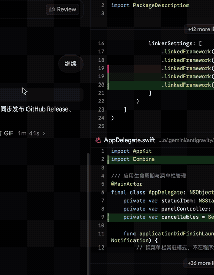

# iClip

> 只有 **1.2 MB**、零第三方依赖、采用苹果 macOS 原生液态玻璃（Liquid Glass）打造的轻量菜单栏剪贴板。

按下 **`⌥V`**（支持自定义快捷键），苹果原生液态玻璃面板在你的**鼠标光标旁**直觉出现；**双击任意记录**（或按回车）直接键入光标所在区域，让每天高频发生的复制粘贴顺手又丝滑。

<p align="center">
  
</p>

> 📥 **双角色专属安装包（开箱即用 + 应用内一键切轨 OTA）**：
> 前往 [GitHub Releases](https://github.com/fanaruto/iClip/releases/latest) 按你的主力场景选择，后续也可随时在 **设置 → 使用角色与专属版本** 中一键跨版本 OTA 热切换（保留全部历史与辅助功能权限）：
> - 👨‍💻 **极客开发与 AI 版（`iClip-Dev-macOS.zip`）**：微秒级语义识别、敏感密钥 AI 结构化脱敏、URL 净链、JSON / 时间戳 / Base64 / cURL / SQL `IN` 瞬变、QuickLook 对照预览、`{{clip_redacted}}` 动态模板插值。
> - ⚡️ **商务与心流办公版（`iClip-Flow-macOS.zip`）**：FIFO 顺序粘贴队列（`⌃⌥V` 免开面板连填表单 + 自动 `Tab` 跳格）、Apple Vision 离线中英实况文本 OCR 搜图识字、多选跨模态合并粘贴、收藏场景分组槽与备注标题别名。

---

## 为什么做 iClip？

市面上不缺剪贴板工具，但总觉得差一点意思：

- 有的太重，装完动辄几十上百兆，后台常驻内存居高不下；
- 有的视觉割裂，像上个世纪的表格列表，和原生系统格格不入；
- 有的把程序员工具和日常办公功能大杂烩堆满屏幕，彼此干扰。

于是我从第一性原理用纯原生架构写下了 **iClip**：苹果官方液态玻璃底座 + 按人群痛点编译隔离的双专属角色版本，极轻、极快、开源免费。

---

## 核心特性

### 1. 顶部 3D 透视瀑布错峰出场
- 按下 **`⌥V`**，毛玻璃浮窗从屏幕顶部中央带着轻微 3D 倾角弹性滑落，内部条目按行错峰浮现，同排图片如涟漪般依次落位。
- 选完自动向上微仰收起，焦点无缝交还上一个应用，行云流水不打断思路。

### 2. 图片 3 列相册网格 + 悬停放大预览
- 连续复制的多张截图或图片，自动聚合成 **每行 3 张** 的圆角相册网格，紧凑又直观。
- 鼠标滑过任意图片，当前图格会弹性放大浮起；同时在列表另一半区域（**智能避让鼠标位置，绝不挡手**）弹出完整原比例的高清大图预览，看清细节后单击即贴。

### 3. 全类型自动归档与隐私守护
- **文本**：自动去重并置顶，保留换行，支持实时关键词搜索。
- **网页链接**：自动识别域名，右键一键在浏览器打开。
- **图片与截图**：本地压缩存储 + 内存缩略图缓存，滚动百条记录依然丝滑。
- **单个或多个文件**：保留真实文件引用（可直接粘贴到访达或聊天窗口），右键支持仅复制路径或在访达中定位。
- **隐私保护**：自动跳过主流密码管理器的临时敏感剪贴内容，支持一键暂停/恢复监听。

### 4. 纯粹的键盘流体验

| 快捷键 | 功能说明 |
| :--- | :--- |
| **`⌥ V`** | 全局呼出 / 隐藏（支持全屏应用与多桌面空间） |
| **`↑` / `↓`** | 上下切换历史条目（自动识别中文输入法组字，回车上屏不误触） |
| **`↵` 回车** | 复制并自动粘贴到上一个应用 |
| **`⌘ 1` ~ `⌘ 9`** | 一键粘贴前 9 条记录 |
| **`⌘ ⌫`** | 删除当前选中项 |
| **`ESC`** | 快速关闭面板 |

---

## 快速构建与安装

**系统要求**：macOS 14.0 及以上（需要已安装系统命令行工具）

```zsh
# 1. 克隆仓库
git clone https://github.com/fanaruto/iClip.git
cd iClip

# 2. 一键编译并打包成应用（产物仅约 1.2 MB）
./build_app.sh

# 3. 启动体验
open dist/iClip.app
```

- **长期使用**：将 `dist/iClip.app` 拖入「应用程序」文件夹即可。
- **开启自动粘贴**：首次使用点击条目会写入系统剪贴板；如需选中后自动发送 `⌘V` 直接粘贴，在面板右上角 **齿轮设置 → 辅助功能权限 → 前往开启** 即可。

---

## 数据与隐私

- **完全离线（仅更新检查访问 GitHub）**：剪贴内容零上传、无统计埋点、无账号体系；内置基于 GitHub Releases 的一键 OTA 更新，仅在检查或下载新版本时访问 `api.github.com`。
- **本地存储**：所有历史记录与压缩图片均保存在本机 `~/Library/Application Support/QingJian/`，支持自定义保留上限（50 / 100 / 200 / 500 条），收藏置顶项不受清理影响。

---

## 项目结构

```text
iClip/
├── Sources/QingJian/
│   ├── Models/ClipItem.swift              # 剪贴记录数据模型与分类
│   ├── Services/ClipboardStore.swift      # 监听、去重、缓存、持久化与自动粘贴
│   ├── Services/HotKeyManager.swift       # 全局快捷键注册（⌥V）
│   ├── Window/FloatingPanelController.swift # 无边框悬浮窗、定位与键盘流控制
│   ├── Views/ClipboardPopoverView.swift   # 主面板、3D 瀑布动效、设置页
│   ├── Views/ClipCardView.swift           # 文本/链接/文件单行卡片
│   ├── Views/ClipImageGridTile.swift      # 3 列图片网格与智能避让高清预览
│   ├── AppDelegate.swift                  # 菜单栏常驻与右键菜单
│   └── main.swift                         # 应用入口
├── build_app.sh                           # 一键编译与打包脚本
└── Package.swift                          # 工程配置
```

---

## 开源协议

本项目基于 **MIT 协议** 开源，欢迎点星、提建议或提交改进。
